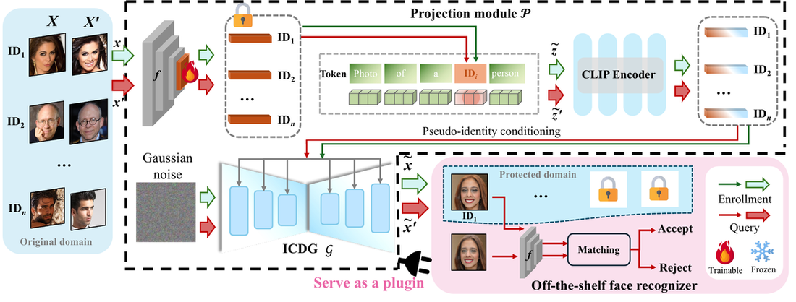
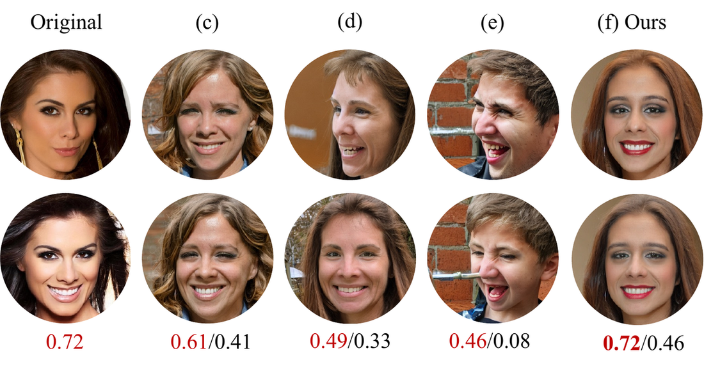

# PPID: Plug-and-Play Identity

**Plug-and-Play Identity: Generative Pseudo-Identities for Privacy-Preserving Face Recognition**

MM '26 | Rio de Janeiro, Brazil | November 10–14, 2026  
DOI: [10.1145/3767308.3835307](https://doi.org/10.1145/3767308.3835307)  
Built on [Arc2Face](https://github.com/foivospar/Arc2Face).

<p align="center">
  
  <br/>
  <em>Overview of PPID</em>
</p>

<p align="center">
  
  &nbsp;&nbsp;
  
  <br/>
  <em>Diverse protected faces (different seeds; Original at the end)</em>
</p>

<p align="center">
  
</p>

## Setup

```bash
conda create -n ppid python=3.10 -y && conda activate ppid
pip install -r requirements.txt
pip install git+https://github.com/openai/CLIP.git
python scripts/download_models.py --local_dir ./models
```

Place InsightFace `antelopev2` under `models/antelopev2`. Put IP weights at `checkpoints/perturbor_best.pth`.

## Train

```bash
python scripts/train_perturbor.py \
  --data_root /path/to/ffhq \
  --arc2face_model_dir ./models \
  --insightface_root ./ \
  --output_dir ./checkpoints \
  --device cuda:0
```

## Anonymize

```bash
python scripts/anonymize.py \
  --image_dir /path/to/faces \
  --perturbor_ckpt ./checkpoints/perturbor_best.pth \
  --arc2face_model_dir ./models \
  --insightface_root ./ \
  --output_dir ./outputs/anonymized \
  --device cuda:0
```

## Citation

```bibtex
@inproceedings{zhang2026ppid,
  title     = {Plug-and-Play Identity: Generative Pseudo-Identities for Privacy-Preserving Face Recognition},
  author    = {Zhang, Hui and Wu, Aming and Cui, Shujie and Dong, Xingbo and Tan, Chenchen and Liu, Xiao and Jiang, Frank and Jin, Zhe and Li, Xuejun},
  booktitle = {Proceedings of the 34th ACM International Conference on Multimedia (MM '26)},
  year      = {2026},
  month     = {November},
  address   = {Rio de Janeiro, Brazil},
  publisher = {ACM},
  pages     = {1--14},
  doi       = {10.1145/3767308.3835307},
  isbn      = {979-8-4007-2213-4/2026/11}
}
```
